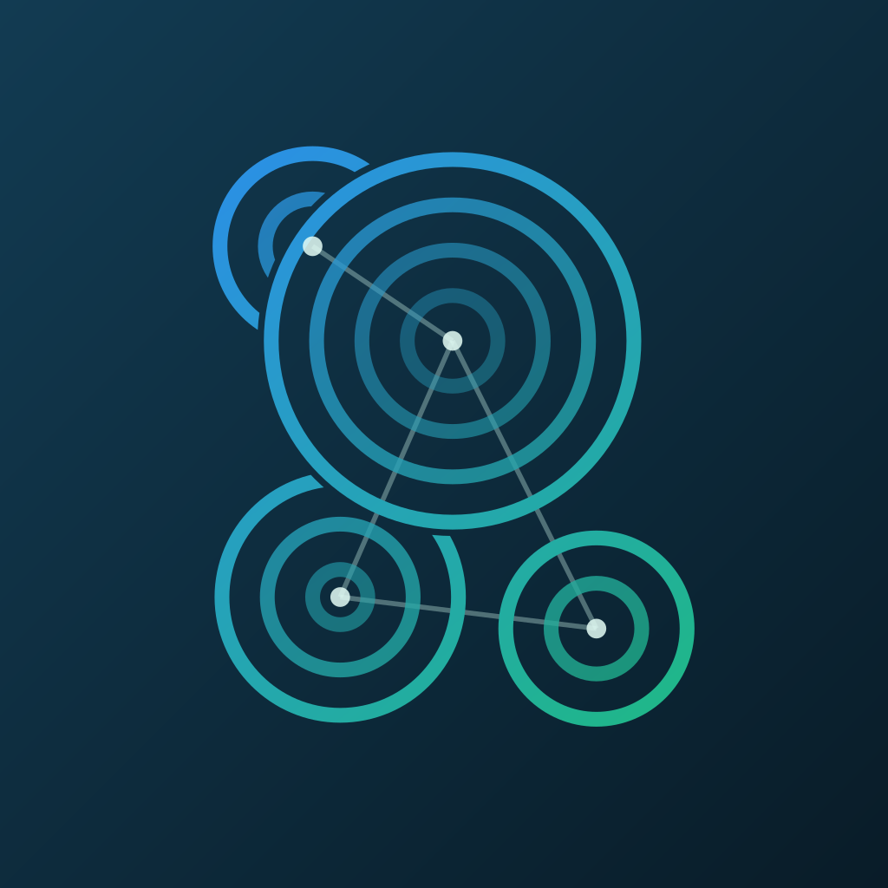
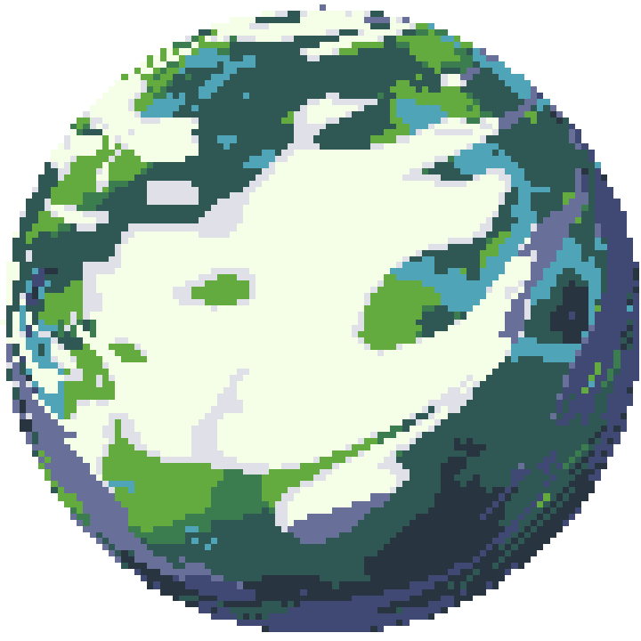

  

  # [💫 Galaxaris](https://galaxaris.fr)

  **Promouvoir le développement. Explorer de nouvelles technos.**

  

    
    
    
  

---

## 🚀 A propos
Galaxaris est une association de loi 1901 composée de passionnés, dédiée à la promotion du développement de projets informatiques et à la découverte de nouvelles technologies. Née d'un projet de première année à l'Efrei (Paris), nous unissons notre créativité et nos compétences pour concevoir des outils innovants, des expérimentations techniques, et de véritables expériences logicielles (comme le projet Omicronde).

* ### **[Omicronde API](https://github.com/galaxaris/api)**: Une librairie Python puissante, complète et simple d'utilisation pour créer des jeux et des applications interactives.
* ### **[Omicronde Editor](https://github.com/galaxaris/editor)**: Un éditeur convivial pour créer et gérer les ressources et niveaux d'un jeu (_encore en développement_).
* ### **[Robot Recovery](https://github.com/galaxaris/robot-recovery)**: Un jeu de plateforme éducatif et amusant, parlant de notre futur et de l'importance de prendre soin de notre planète.
* ### **[RuraLien](https://github.com/galaxaris/ruralien)**: Une application de communication hors-réseau pour les zones rurales, utilisant un boîtier LoRa (ESP32) pour créer un réseau local maillé.

## 🛠 The Squad
Rencontrez les cerveaux derrière la galaxie :

* **[Lisa LECHANI](https://github.com/Aomm-lgtm)**
* **[Gautier PIRET](https://github.com/GauGoth-Corp)**
* **[Lazare GOUTTEBROZE](https://github.com/Guimauve39631)**
* **[Raphaël PICOT](https://github.com/raphixscrap)**
* **[Axel GIRARD](https://github.com/Axelotl-30)**
* **[Bastian Gbéblewo--Mutel](https://github.com/Mango000000000)**

---

## 🍏 Projet en cours : [RuraLien]

*Application de communication*

Application de communication hors-réseau pour les zones rurales.
Couplé au Module RuraLien, utilisant un boîtier LoRa (ESP32), il permet de créer un réseau local maillé pour communiquer sans dépendre d'Internet (zones blanches, montagne, festivals, camps scouts, situations d'urgence).

> **Statut :** 🛸 En développement - nous travaillons actuellement sur la première version Beta, avec des fonctionnalités supplémentaires prévues pour les prochaines versions.

<!-- Play Store, Web, iOS, Windows, Mac, Linux, Vue -->

    
    
    
    
    
    
    
    
    

<a target="_blank" href="https://ruralien.galaxaris.fr">

</a>

## 🎮 Autre projet: [Robot Recovery]
*Jeu de plateforme Pygame*

> **Statut :** 🛸 Terminé - nous implémenterons peut-être des fonctionnalités supplémentaires dans un futur proche !

> **Arbre du Projet Omicronde** Vous pouvez visualiser la structure du projet ici : [PROJECT_TREE.md](PROJECT_TREE.md)

<a target="_blank" href="https://github.com/galaxaris/robot-recovery">

</a>

---

  <i>Copyright © 2025-2026 Galaxaris - Tous droits réservés.</i>

