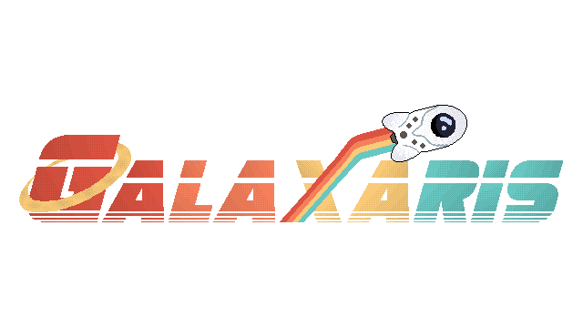

  

  # 💫 Galaxaris

  **Creating cosmic experiences, one pixel at a time.**

  

    
    
  

---

## 🚀 About Us
Galaxaris is a game studio composed of **five wonderful developers** dedicated to pushing the boundaries of indie gaming. Created for a first year project at **Efrei Engineering School** (Paris), we pushed the boundaries of our creativity and technical skills to create a unique gaming experience. We learnt a lot of things during these two months of development: how to work as a team, manage a project, create a complete game engine, and of course how to create a video game!

* ### **[Omicronde API](https://github.com/galaxaris/api)**: A very powerful, complete and easy-to-use Python library for game development
* ### **[Omicronde Editor](https://github.com/galaxaris/editor)**: A user-friendly editor for creating and managing game assets and levels (_still in development_).
* ### **[Robot Recovery](https://github.com/galaxaris/game)**: A fun and educational platformer game about our future and the importance of taking care of our planet.

## 🛠 The Squad
Meet the brains behind the galaxy:

* **[Lisa LECHANI](https://github.com/Aomm-lgtm)**
* **[Gautier PIRET](https://github.com/GauGoth-Corp)**
* **[Lazare GOUTTEBROZE](https://github.com/Guimauve39631)**
* **[Raphaël PICOT](https://github.com/raphixscrap)**
* **[Axel GIRARD](https://github.com/Axelotl-30)**

---

## 🎮 Current Project: [Robot Recovery]
*Pygame Platformer.*

> **Status:** 🛸 Finished - maybe we will implement other updates in a near future!

> **Project Omicronde's Tree:** Here you can get an overview of how the project is actually structured: [PROJECT_TREE.md](PROJECT_TREE.md)

---

  <i>Copyright © 2026 Galaxaris - All Rights reserved</i>

